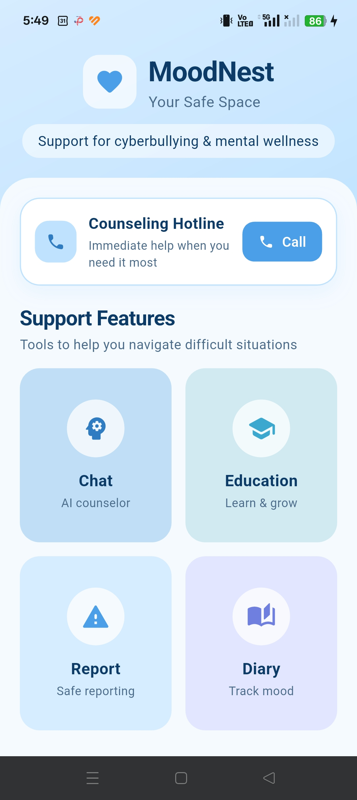
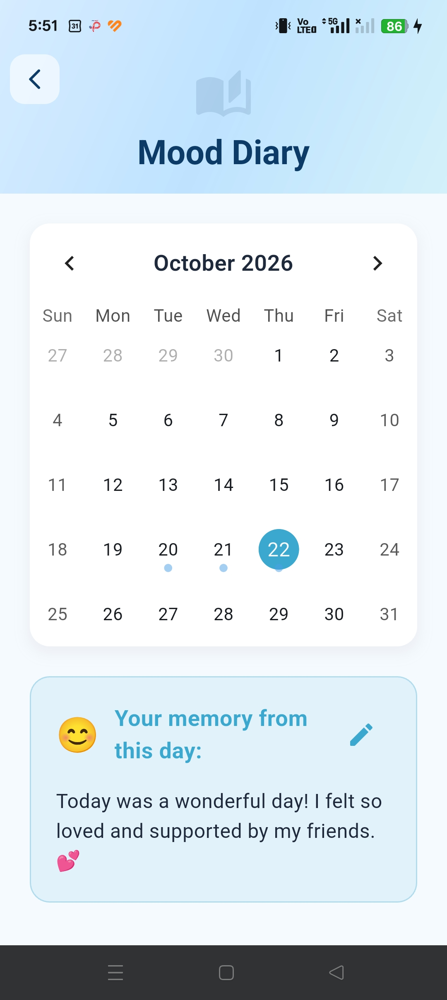
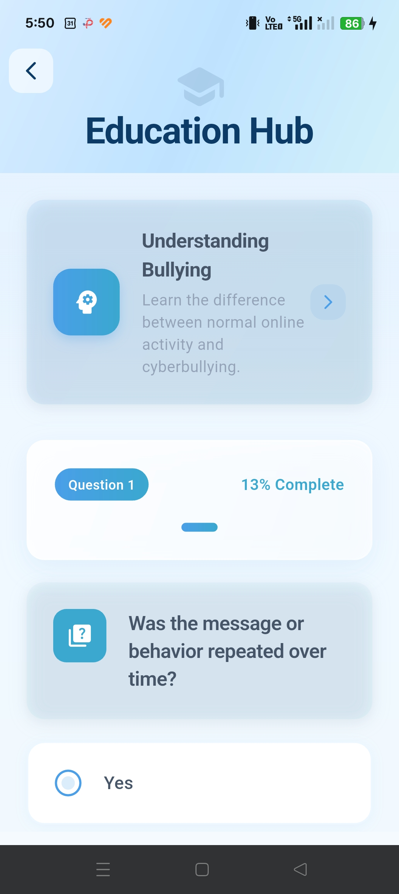
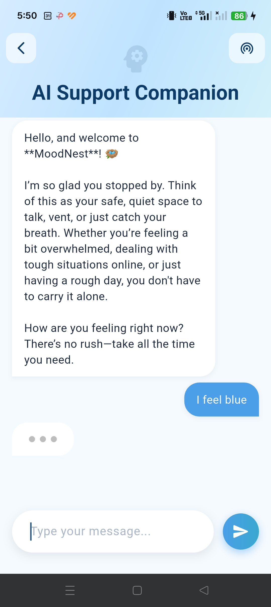

<div align="center">

# 🪺 MoodNest

### Your safe space against cyberbullying

A Flutter app that helps young people deal with cyberbullying and look after their mental wellness: talk to an AI counselor, call a hotline, report incidents, learn, and track your mood, all in one calm place.


</div>

---

## Screenshots

<!-- Put your phone screenshots in a "screenshots" folder and use these file names -->
<p align="center">
  
  
</p>

<p align="center">
  
  
  
</p>

## Features

| | Feature | What it does |
|---|---|---|
| 📞 | **Counseling Hotline** | One tap to reach counseling and emergency support |
| 🤖 | **AI Chat** | A caring AI counselor (Google Gemini) that's there 24/7 |
| 📚 | **Education** | Spot the signs of cyberbullying with real example cases |
| 🛡️ | **Report** | Record incidents safely, with screenshots as evidence |
| 📔 | **Diary** | Track your mood on a calendar and see how you're doing |

## Getting started

```bash
git clone https://github.com/yuhuing/MoodNest.git
cd MoodNest
flutter pub get
```

**Add your Gemini API key** (free from [Google AI Studio](https://aistudio.google.com/app/apikey)): copy `lib/services/api_key.example.dart` to `api_key.dart` in the same folder and paste in your key. It's git-ignored, so it never gets uploaded.

Then plug in your phone (or start an emulator) and run:

```bash
flutter run
```

## Built with

[Flutter](https://flutter.dev) · [Gemini API](https://pub.dev/packages/google_generative_ai) · [table_calendar](https://pub.dev/packages/table_calendar) · [image_picker](https://pub.dev/packages/image_picker) · [flutter_phone_direct_caller](https://pub.dev/packages/flutter_phone_direct_caller)

## Troubleshooting

- **Red errors everywhere after cloning?** Run `flutter pub get`, then reload VS Code.
- **AI chat not replying?** Check `lib/services/api_key.dart` exists with a valid key.
- **Gradle build error?** Don't accept "Upgrade Gradle" prompts; this project uses Gradle 8.14.3.

## Team

- **Ng Yu Hui** ([@yuhuing](https://github.com/yuhuing))
- **Chai Shun Ying** ([@ChaiShunYing](https://github.com/ChaiShunYing))

